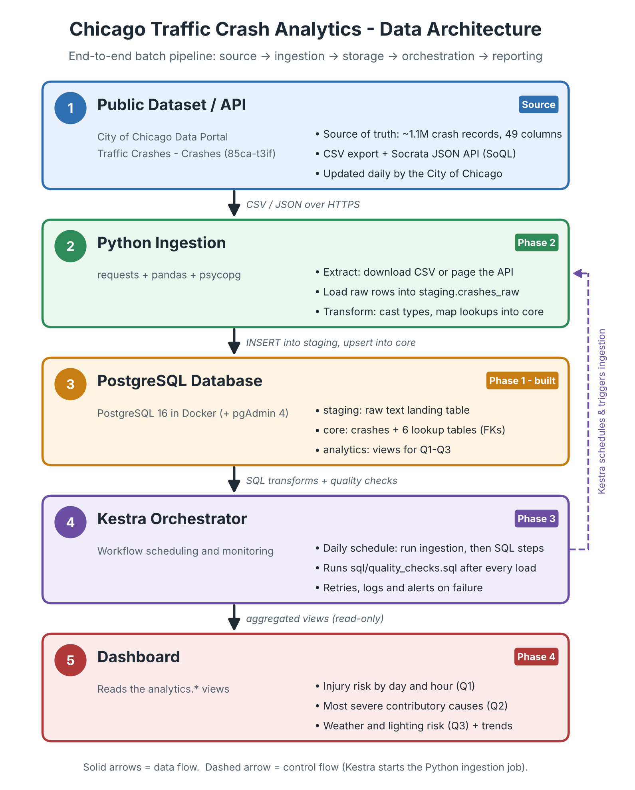

# Chicago Traffic Crash Analytics
### An End-to-End Data Engineering Pipeline for Public Road-Safety Data

| | |
|---|---|
| **Course** | Data Engineering (INF 4058) |
| **Instructor** | Eng. Mariam El-Habashi |
| **Submission** | Phase 1 – Project Proposal |
| **Date** | 13 November 2026 |
| **Video walkthrough** | [https://drive.google.com/file/d/1_5G8RHkdUjO4ONicAv35nI8971htInrL/view?usp=drive_link](https://drive.google.com/file/d/1_5G8RHkdUjO4ONicAv35nI8971htInrL/view?usp=drive_link) |
| **GitHub repository** | [https://github.com/Zeko0Z/chicago-crash-analytics](https://github.com/Zeko0Z/chicago-crash-analytics) |

_Phase 1 project proposal. The PDF version is `docs/proposal.pdf`._

## 1. Project Title

**Chicago Traffic Crash Analytics** – An End-to-End Data Engineering Pipeline for Public Road-Safety Data.

## 2. Project Overview

This project builds a batch data pipeline around the City of Chicago's public traffic crash data. Python scripts will extract the data from the Chicago Data Portal, load it into a PostgreSQL database with raw, cleaned and reporting layers, and Kestra will run the pipeline every day. A dashboard will present the answers to three road-safety questions.

Phase 1 (this submission) covers the dataset choice, the analytical questions, the database design, the architecture and a working Docker environment with PostgreSQL and pgAdmin. Ingestion, orchestration and the dashboard are planned for later phases and are not claimed as complete here.

## 3. Problem Statement and Motivation

Traffic crashes are a major public-safety problem in large cities. The City of Chicago publishes every police-reported crash, but the raw data is large (over one million rows), changes every day, and contains missing and inconsistent values. In this form it is hard for planners, police or the public to answer simple questions such as: *When is the risk of injury highest? Which driver behaviours cause the worst crashes? Do bad weather and darkness really increase injuries?*

A reliable pipeline that cleans, models and refreshes this data automatically turns it into evidence that can guide decisions, for example where to focus enforcement, when to run awareness campaigns, and which conditions need better lighting or road treatment. The project is also a realistic Data Engineering case: a large, real, daily-updated source with known quality issues.

## 4. Dataset Description

**Traffic Crashes – Crashes** contains one record per traffic crash on city streets within the City of Chicago and under the jurisdiction of the Chicago Police Department (CPD). Records come from CPD's electronic crash reporting system (E-Crash) and mostly follow the Illinois Department of Transportation SR1050 crash report form. Each row describes when and where the crash happened, road and environment conditions, the officer's judgement of the causes, the estimated damage and the number of people injured.

Two related datasets on the same portal – *Traffic Crashes – People* and *Traffic Crashes – Vehicles* – share the key CRASH_RECORD_ID. They are not part of Phase 1 but make the design easy to extend.

### Dataset selection

Several public datasets were evaluated against the course criteria (NYC Taxi data was excluded as required):

| Candidate | Size | Formats | Assessment |
|---|---|---|---|
| Chicago Traffic Crashes – Crashes | 1.1 M rows, 49 cols | CSV, JSON API | **Selected.** Rich dates, numbers and categories; documented; daily updates; related datasets by key. |
| UCI Online Retail II | ~1 M rows, 8 cols | XLSX | Good e-commerce data, but Excel only and few columns; static (no updates). |
| Olist Brazilian E-Commerce (Kaggle) | ~100 k orders, 9 files | CSV | Very relational, but needs a Kaggle login and is a static snapshot. |
| WA Electric Vehicle Population | ~200 k+ rows | CSV, JSON API | Public API, but no event dates (model year only) – weak for time analysis. |

The Chicago crash dataset scores best on data quality (official source with column documentation), size, analytical potential, relationships, ease of download (no login; CSV and API) and suitability for future ETL (daily updates make incremental loading and orchestration meaningful).

## 5. Dataset Source and Link

| Item | Value |
|---|---|
| Publisher | City of Chicago Data Portal (data.cityofchicago.org) |
| Dataset page | https://data.cityofchicago.org/d/85ca-t3if |
| CSV download | https://data.cityofchicago.org/api/views/85ca-t3if/rows.csv?accessType=DOWNLOAD |
| JSON API (SODA) | https://data.cityofchicago.org/resource/85ca-t3if.json |
| Update frequency | Daily |
| Licence | City of Chicago Data Portal Terms of Use (linked on the dataset page) |

## 6. Number of Rows and Columns

All figures below were obtained by querying the official Socrata API on **12 November 2026**. The dataset grows daily, so the row count at submission time will be slightly higher.

| Measure | Value | How it was verified |
|---|---|---|
| Rows (crashes) | **1,112,485** | API: $select=count(*) |
| Published columns | **49** | API column metadata (columns.json) |
| Earliest / latest crash date | 2013-03-03 / 2026-11-10 | API: min / max of crash_date |
| Distinct CRASH_RECORD_ID | Unique per row (PK) | Damage and cause groups each sum to 1,112,485 |

### Known data quality issues

| Issue | Evidence (12 Nov 2026) | Handling |
|---|---|---|
| Partial coverage before Sept 2017 | 99,242 crashes (8.9%) dated before 2017-09-01; source says citywide data starts Sept 2017 | Analysis window 2018–2025; check B02 |
| Undetermined primary cause | 440,136 'UNABLE TO DETERMINE' (39.6%) + 57,391 'NOT APPLICABLE' | Flag is_undetermined; excluded in Q2 |
| Unknown weather | 68,323 crashes (6.1%) with 'UNKNOWN' | Excluded in Q3; check B13 |
| Missing coordinates | 8,730 crashes (0.8%) with no latitude | Kept; check B08 / B09 |
| Missing injury counts | 2,388 crashes with no injuries_total | Counted as non-injury; check B07 |
| Mixed name for one column | CSV header NOT_RIGHT_OF_WAY_I = API field private_property_i | Mapped in staging |
| Records change over time | Reports are amended; dataset updated daily | Upsert on crash_record_id |

## 7. Data Types and Important Fields

Source types are as published by the portal (text, number, calendar_date, point). The PostgreSQL types are those used in core.crashes. The full list of all 49 columns is in docs/data_dictionary.md.

| Field | Source type | PostgreSQL type | Role |
|---|---|---|---|
| CRASH_RECORD_ID | text | VARCHAR(128) | Primary key; link to People / Vehicles |
| CRASH_DATE | calendar_date | TIMESTAMP | Date dimension (Q1, trends) |
| CRASH_HOUR / CRASH_DAY_OF_WEEK / CRASH_MONTH | number | SMALLINT | Time parts (day 1 = Sunday) |
| WEATHER_CONDITION / LIGHTING_CONDITION | text | FK → lookup | Categories (Q3) |
| PRIM_CONTRIBUTORY_CAUSE / SEC_... | text | FK → lookup | Categories (Q2); 40 distinct values |
| FIRST_CRASH_TYPE / ROADWAY_SURFACE_COND | text | FK → lookup | Categories |
| DAMAGE | text | FK → lookup | 3 bands: ≤ $500, $501–$1,500, > $1,500 |
| INJURIES_TOTAL / _FATAL / _INCAPACITATING … | number | SMALLINT | Measures (Q1–Q3) |
| POSTED_SPEED_LIMIT / NUM_UNITS / LANE_CNT | number | SMALLINT / INTEGER | Measures |
| LATITUDE / LONGITUDE | number | NUMERIC(9,6) | Location (maps) |
| HIT_AND_RUN_I and other *_I flags | text (Y/N) | BOOLEAN | Indicators |

## 8. Analytical Questions

All three questions use complete calendar years **2018–2025**, because citywide data starts in September 2017 and 2026 is not finished yet.

### Q1 – When is a crash most likely to injure someone?

| Aspect | Detail |
|---|---|
| Business question | Between 2018 and 2025, which day-of-week and hour-of-day combinations have the highest percentage of crashes with at least one injury, and how does that compare with when crashes are most frequent? |
| Why it matters | Busy hours are not always the most dangerous ones. Knowing the high-risk time windows helps target police patrols, signal timing and safety campaigns at the right moments. |
| Required columns | crash_date, crash_day_of_week, crash_hour, injuries_total, injuries_fatal, injuries_incapacitating |
| Expected output | A 7 × 24 table/heatmap with crash count, injury-crash %, severe crashes per 1,000 and a rank; top-10 riskiest windows. |
| SQL approach | GROUP BY crash_day_of_week, crash_hour with COUNT(*) FILTER (WHERE injuries_total > 0) / COUNT(*); RANK() window function. View: analytics.v_q1_injury_rate_by_day_hour. |

### Q2 – Which causes lead to the most severe crashes?

| Aspect | Detail |
|---|---|
| Business question | Among primary contributory causes with at least 1,000 crashes in 2018–2025 (excluding 'UNABLE TO DETERMINE' and 'NOT APPLICABLE'), which causes have the highest number of severe crashes (at least one fatal or incapacitating injury) per 1,000 crashes? |
| Why it matters | Common causes are not necessarily the deadliest. This ranking shows which behaviours (e.g. speeding, impaired driving, disregarding signals) deserve priority in enforcement and education. |
| Required columns | prim_contributory_cause, injuries_fatal, injuries_incapacitating, injuries_total, crash_date |
| Expected output | A ranked table (and bar chart) per cause: crashes, fatalities, incapacitating injuries, injury-crash %, severe per 1,000. |
| SQL approach | JOIN core.contributory_cause; WHERE NOT is_undetermined; GROUP BY cause HAVING COUNT(*) >= 1000; ratio of FILTERed counts; RANK(). View: analytics.v_q2_cause_severity. |

### Q3 – How do weather and lighting change injury risk?

| Aspect | Detail |
|---|---|
| Business question | For each combination of weather and lighting condition with at least 500 crashes in 2018–2025, what is the injury-crash percentage relative to the overall average (relative risk), and what share of crashes caused more than $1,500 of damage? |
| Why it matters | It tests whether rain, snow or darkness really make crashes worse, which supports decisions about street lighting, winter road treatment and weather-related warnings. |
| Required columns | weather_condition, lighting_condition, injuries_total, damage, crash_date |
| Expected output | A table/heatmap of weather × lighting with crash count, injury-crash %, % over $1,500 and relative risk (1.00 = average). |
| SQL approach | CTE for the filtered base, CROSS JOIN with the overall injury rate, GROUP BY weather, lighting HAVING COUNT(*) >= 500. View: analytics.v_q3_weather_lighting_risk. |

## 9. Proposed PostgreSQL Database Design

The database **chicago_crashes** uses three schemas, a common layered design that keeps raw data, clean data and reporting logic separate:

- **staging** – crashes_raw: a raw copy with all 49 source columns as TEXT plus load metadata. No constraints, so loading never fails; problems are found by quality checks instead.
- **core** – crashes (fact table, one row per crash, PK crash_record_id) plus six lookup tables: weather_condition, lighting_condition, roadway_surface_condition, first_crash_type, contributory_cause and damage_category.
- **analytics** – views that join the lookups and answer Q1–Q3, plus a monthly trend view for the dashboard.

| Table | Primary key | Foreign keys / relationships |
|---|---|---|
| core.crashes | crash_record_id | 7 FKs to the lookups (cause is used twice: primary and secondary) |
| core.weather_condition | weather_condition_id | 1 → many core.crashes |
| core.lighting_condition | lighting_condition_id | 1 → many core.crashes |
| core.roadway_surface_condition | roadway_surface_condition_id | 1 → many core.crashes |
| core.first_crash_type | first_crash_type_id | 1 → many core.crashes |
| core.contributory_cause | contributory_cause_id | 1 → many core.crashes (×2) |
| core.damage_category | damage_category_id | 1 → many core.crashes; seeded with 3 bands and USD ranges |
| staging.crashes_raw | none (raw) | Logical link to core.crashes via crash_record_id (ETL) |

### Normalization considerations

- **1NF:** atomic values only; the source LOCATION point is not stored because it repeats latitude and longitude.
- **2NF:** single-column primary key, so no partial dependencies.
- **3NF:** repeated category labels used in analysis are moved to lookup tables (no update anomalies, less storage on 1.1 M rows).
- **Deliberate denormalization:** crash_hour, crash_day_of_week and crash_month are kept for fast grouping; a quality check verifies they match crash_date. Low-value labels stay as VARCHAR to keep Phase 1 simple.
- **Integrity:** CHECK constraints (hour 0–23, day 1–7, month 1–12, non-negative counts, valid coordinates), a NOT NULL crash_date, and indexes on the date and every FK.
- **Quality:** sql/quality_checks.sql defines 20 checks (duplicates, nulls, future dates, inconsistent injury totals, coordinates outside Chicago, outliers, staging-to-core reconciliation).

The schema, views and checks were executed and tested on PostgreSQL 16 (including constraint and foreign-key violation tests with sample rows). Complete column-level documentation is in docs/data_dictionary.md.

## 10. Architecture Diagram

*Figure 1 – Data architecture: Public Dataset/API → Python Ingestion → PostgreSQL → Kestra → Dashboard.*

| Component | Responsibility | Phase |
|---|---|---|
| Public Dataset / API | Chicago Data Portal publishes crash data as CSV and JSON through the Socrata API; the single source of truth. | Source |
| Python Ingestion | Extracts full and incremental data, bulk-loads it into staging, then casts types, fills lookups and upserts into core. | 2 |
| PostgreSQL Database | Stores raw (staging), clean (core) and reporting (analytics) data; enforces keys and constraints. Runs in Docker with pgAdmin. | 1 (built) |
| Kestra Orchestrator | Schedules the pipeline daily, runs SQL transforms and the quality checks, retries and alerts on failure. Triggers the Python job (dashed arrow). | 3 |
| Dashboard | Reads the analytics views and shows Q1–Q3 as heatmaps, ranked bars and trend lines. | 4 |

## 11. Technologies and Tools

| Technology | Purpose |
|---|---|
| Docker & Docker Compose (v2.24+) | Reproducible local environment; one command starts all services |
| PostgreSQL 16 (official postgres:16-alpine image) | Relational database for staging, core and analytics layers |
| pgAdmin 4 (dpage/pgadmin4:9) | Web interface to browse the database and run SQL |
| Python 3.11+ (requests, pandas, psycopg) | Extraction and loading (Phase 2) |
| SQL (PostgreSQL dialect) | Schema, transformations, quality checks, analytical views |
| Kestra | Workflow orchestration and scheduling (Phase 3) |
| Dashboard tool (e.g. Metabase or Apache Superset – to be confirmed) | Visualisation of the analytical questions (Phase 4) |
| Git & GitHub | Version control and collaboration; .env excluded via .gitignore |

## 12. Team Members and Assigned Roles

| # | Full Name | University ID | Role |
|---|---|---|---|
| 1 | Zeyad Nasr Elden Mohamed | 692300288 | Database & Docker Engineer (PostgreSQL schema, Docker environment, GitHub repository) |
| 2 | Ahmed Mohamed Wageh | 692300198 | Analytical questions and proposal preparation |
| 3 | Mohamed Magdy | 692300414 | Docker, PostgreSQL and pgAdmin |
| 4 | Abdelrhamn Mohamed Saad | 692300260 | Architecture diagram and GitHub |
| 5 | Ahmed Maged Saaed | 692300096 | Project review and video preparation |

## References

- City of Chicago Data Portal – Traffic Crashes – Crashes: https://data.cityofchicago.org/d/85ca-t3if
- City of Chicago Data Portal – Traffic Crashes – People: https://data.cityofchicago.org/d/u6pd-qa9d
- City of Chicago Data Portal – Traffic Crashes – Vehicles: https://data.cityofchicago.org/d/68nd-jvt3
- pgAdmin 4 container deployment documentation: https://www.pgadmin.org/docs/pgadmin4/latest/container_deployment.html
- PostgreSQL official Docker image: https://hub.docker.com/_/postgres
